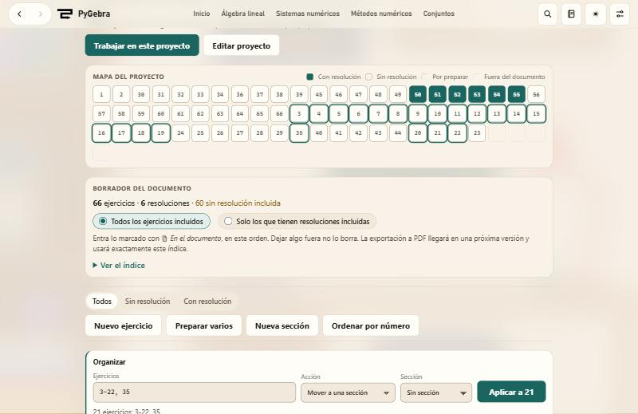
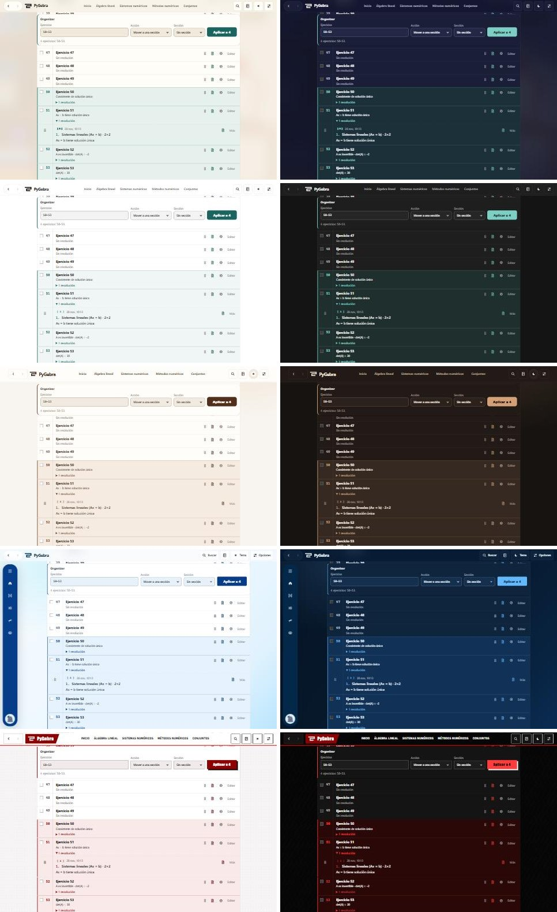
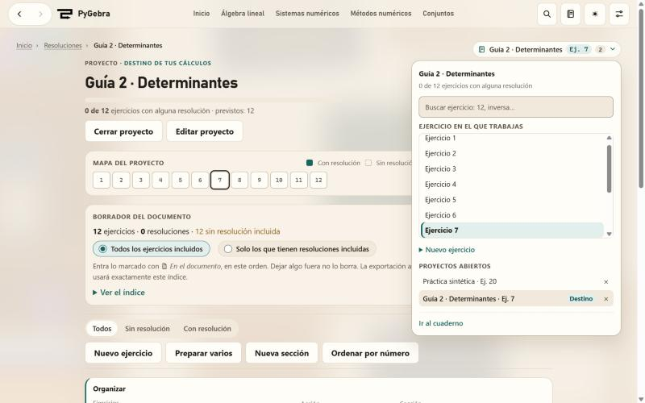
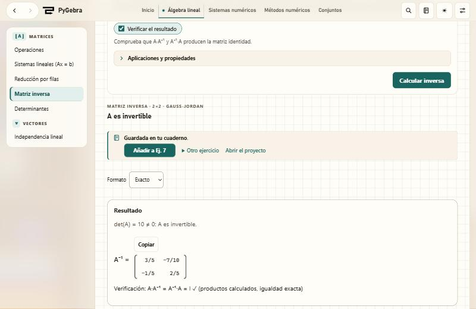
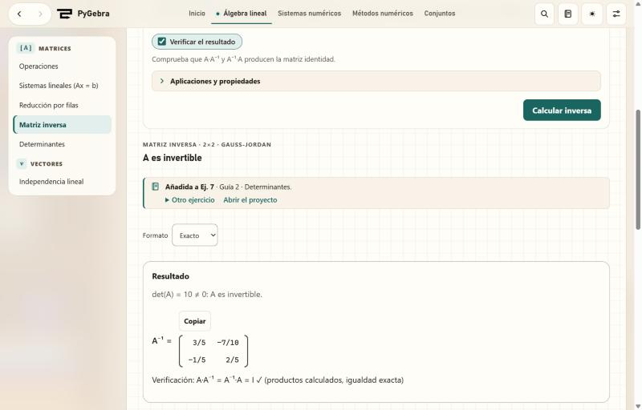
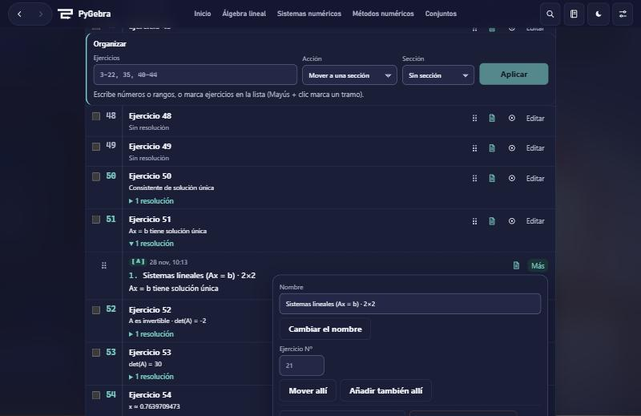
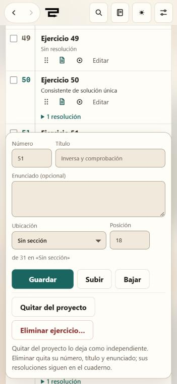
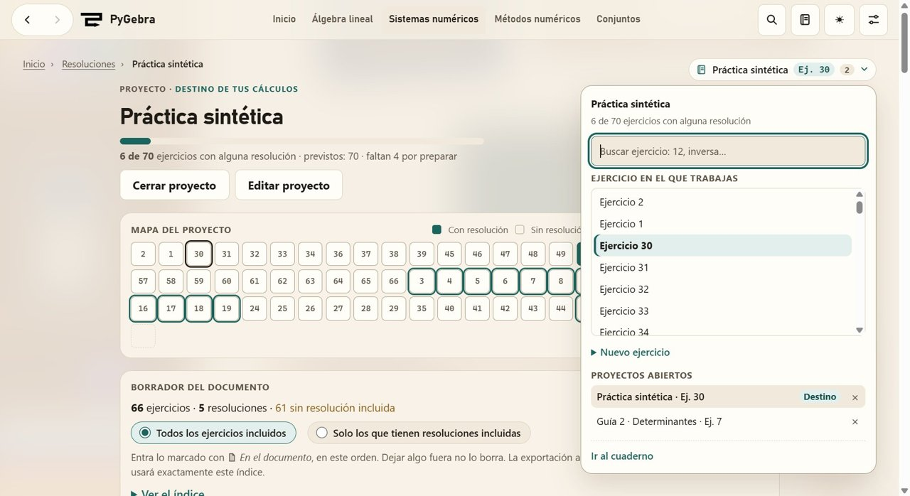

# Cuaderno de resoluciones

[Índice de documentación](README.md) · [Arquitectura](arquitectura.md)

Cada resolución válida de la interfaz visual se anota sola en un cuaderno local. Desde
**Resoluciones** (cabecera) se consulta, se busca por nombre, resultado, ejercicio o
proyecto, se filtra por herramienta y fecha, se renombra, se elimina y se organiza en
**Proyecto → Sección → Ejercicio → Resoluciones**. Abrir una resolución lleva a su
herramienta con los datos, el resultado y el procedimiento originales, sin volver a calcular.



## Uso

- **Guardar.** Al calcular, el aviso del resultado dice en una línea qué pasó y dónde está:
  *Guardada en tu cuaderno*, *Ya estaba en tu cuaderno* (recalcular lo mismo no la repite),
  *Añadida a Ej. 7 · Guía 2* (tras añadirla) o el motivo si no se pudo guardar. *Desde tu
  cuaderno* queda solo para las consultas históricas (`?resolucion=`).
- **Una resolución, varios lugares.** Una resolución es el documento matemático; cada
  ejercicio que la usa tiene una **referencia** propia con su orden y su inclusión en el
  documento. *Añadir también allí* la reutiliza sin copiarla (puede estar incluida en un
  proyecto y excluida en otro); *Mover allí* cambia solo ese lugar; *Desvincular de este
  ejercicio* quita solo ese lugar (sin lugares, queda en **Sueltas**); *Eliminar la
  resolución…* la borra del cuaderno y de todos sus lugares tras una confirmación que
  enumera dónde se usa.
- **Selección en el cuaderno.** Las casillas, «marcar el ejercicio o el día» y la barra
  *Añadir a · Eliminar…* trabajan sobre la misma selección.
- **Reabrir.** Si cambias los datos de una resolución reabierta y calculas, se anota una
  resolución nueva; la original no se sobrescribe.
- **Sin perder el sitio.** Con JavaScript, las acciones del cuaderno se aplican sin recargar
  y conservan el desplazamiento, el foco, lo desplegado, los filtros y la selección; lo
  hecho aparece en un aviso breve abajo (también para el lector de pantalla) y las
  confirmaciones, en un diálogo. Sin JavaScript todo funciona con formularios y vuelve a la
  misma página.
- **Cabecera.** Resoluciones usa las clases de Buscar y muestra su nombre desde 1600 px.
  Hasta 640 px y mientras las áreas están en la cabecera con poco espacio (1180–1439 px;
  BelugaCalc las lleva en su riel), Buscar, Tema y Opciones también quedan en icono, como
  ya hacía HeyAlgb, cuyas pestañas se compactan en ese tramo. Con fuentes más anchas que
  Segoe UI (Linux, zoom) las áreas o la marca quedaban debajo de los botones; el runner
  `resoluciones` lo comprueba de 481 a 1600 px en los cinco estilos.

## Proyectos

Un proyecto es un trabajo que se construye poco a poco (una práctica, una guía, una tarea
de clase) y el borrador persistente de su documento.

- **Crear y preparar.** *Nuevo proyecto* (nombre y ejercicios previstos) lo crea, lo abre y
  lo hace destino. *Preparar varios* acepta números y rangos («1-20, 21a, 30»), sin repetir
  los existentes, en una sección existente o en una nueva; desde cada sección, *Preparar
  ejercicios aquí* la deja elegida. *Nuevo ejercicio* crea uno con número, título,
  enunciado y sección.
- **Organizar.** La barra *Organizar*, siempre a mano (fija en pantallas anchas), elige
  ejercicios por número: «4», «3-22», «20-29, 35, 40-44». Un rango sigue el orden natural
  de la numeración (3-22 incluye 3a, no 22a); no distingue mayúsculas y admite guiones
  largos. Las casillas de cada fila suman ejercicios (Mayús + clic marca un tramo). Antes
  de aplicar se ve cuántos y cuáles (también en el mapa); un número inexistente o un rango
  al revés se informan y bloquean, y los huecos de un rango o un número repetido se avisan.
  Acciones: mover a una sección (existente o nueva) o sin sección, mover a otro proyecto,
  quitar del proyecto (quedan independientes), incluir o excluir del documento y eliminar
  ejercicios (siempre con confirmación; sus resoluciones siguen en el cuaderno).
- **Ordenar.** Cada sección, ejercicio y resolución tiene un asa: se arrastra (con
  desplazamiento automático cerca de los bordes, también entre secciones) o, con el foco,
  se mueve con ↑ ↓ Inicio Fin. *Editar → Posición* coloca un ejercicio en un puesto de su
  sección, y *Subir*/*Bajar* funcionan sin JavaScript. *Ordenar por número* aplica el orden
  natural (2 < 10, 3a < 3b, 4.1 < 4.10). Con una vista filtrada (*Sin resolución*, *Con
  resolución*), soltar junto a un ejercicio lo coloca junto a él en el orden completo; los
  ocultos no se mueven. El orden es el del documento.
- **Proyectos abiertos y destino.** El menú junto a las migas dice el único destino de los
  nuevos cálculos (proyecto y ejercicio). Desde él se busca un ejercicio por número o
  título, se crea uno, se cambia a otro proyecto abierto (cada uno recuerda su último
  ejercicio), se abre uno cerrado o se cierra uno sin eliminarlo. Tras calcular, el aviso
  ofrece **Añadir a Ej. N** (un clic) u **Otro ejercicio**. Nada se añade solo. Todo vive en
  el cuaderno, no en el navegador: sobrevive al cierre de la app.
- **Mover y quitar sin perder nada.** *Editar → Ubicación* lleva un ejercicio a otra
  sección, a otro proyecto o fuera de todos. Quitar una sección deja sus ejercicios en el
  proyecto; eliminar un proyecto los deja independientes; eliminar un ejercicio quita su
  número, título y enunciado, y sus resoluciones siguen en el cuaderno.
- **Borrador del documento.** Cada sección, ejercicio y referencia tiene su icono de
  documento (una hoja con la esquina doblada; fuera, tachada y con el texto *Fuera*), que
  no se confunde con las casillas de elegir. El borrador puede llevar *todos los ejercicios
  incluidos* o *solo los que tienen resoluciones incluidas* (preferencia del proyecto).
  Cuenta ejercicios, resoluciones y los que aún no tienen ninguna incluida, y su índice es
  exactamente lo que exportará el PDF. Excluir nunca borra.
- **Progreso.** Cuenta ejercicios *con alguna resolución* sobre los previstos: tener una no
  significa que el ejercicio esté completo. El **mapa** dibuja una casilla por ejercicio en
  el orden del documento (rellena = con resolución, punteada = por preparar, atenuada =
  fuera del documento) y enlaza a cada uno.

## Dónde se guarda

| Situación | Archivo |
| --- | --- |
| App de escritorio | `%LOCALAPPDATA%\PyGebra\resoluciones.sqlite3` |
| Navegador de desarrollo (`manage.py runserver`) | `%LOCALAPPDATA%\PyGebra\resoluciones-desarrollo.sqlite3` |
| `ALGEBRA_RESOLUCIONES` definida | La ruta indicada (worktrees, diagnóstico) |
| Suite y runners de navegador | Un temporal propio (`tests/__init__.py`) |

Fuera de Windows, la carpeta es `~/.local/share/PyGebra`. WebView2 sigue en modo
privado: el cuaderno no depende de su perfil, lo escribe Django.

## Arquitectura

```text
POST herramienta → vista (sin cambios) → TemplateResponse(contexto)
                   └─ ResolucionesMiddleware.process_template_response
                        └─ servicio.guardar → contrato.documento → almacen.guardar
GET herramienta?resolucion=<id>[&tras=anadida&en=<ejercicio>]
                   └─ la vista arma su página vacía (no calcula)
                   └─ servicio.reabrir: formulario y resultado guardados en el mismo contexto
/resoluciones/…    └─ views_resoluciones: páginas y acciones (solo metadatos)
/resoluciones/proyectos/<id>/seleccion/?numeros=… → vista previa JSON de Organizar
```

| Módulo (`frontend/web/calculadora/resoluciones/`) | Responsabilidad |
| --- | --- |
| `contrato.py` | Documento versionado, codificación exacta, huella y validación al leer. |
| `almacen.py` | SQLite (biblioteca estándar): tablas, migraciones, referencias, orden, proyectos abiertos, límites y recuperación. |
| `organizacion.py` | Árbol, documento, progreso, destino activo y selección por números y rangos. |
| `registro.py` | Un `Adaptador` por herramienta: qué guardar, cómo reabrir y cómo leer esquemas anteriores. |
| `servicio.py` | Guardar un contexto válido y prepararlo para reabrir; el aviso. |
| `middleware.py` | Enlaza lo anterior con las vistas sin modificarlas. |

Ninguna vista, motor ni formulario de herramienta cambió. La plantilla común
`layouts/herramienta.html` incluye `components/resolucion_aviso.html`; `base.html`
incluye `components/proyecto_activo.html` junto a las migas (context processor
`proyecto_activo`, una sola conexión por página). `resoluciones.js` envía los formularios
del cuaderno con `fetch`, reemplaza `<main>` con la respuesta (la misma página PRG) y
restaura el contexto; si algo falla, envía el formulario de la forma normal.

### Base de datos (versión 3)

```text
proyectos(id, nombre, objetivo, creado, abierto, ejercicio_activo → ejercicios SET NULL, solo_con_resolucion)
secciones(id, proyecto → proyectos ON DELETE CASCADE, titulo, posicion, incluir)
ejercicios(id, nombre, numero, enunciado, proyecto → SET NULL, seccion → SET NULL, posicion, incluir, creado)
resoluciones(id, huella UNIQUE, ruta, herramienta, nombre, creado, usado, documento)
referencias(id, resolucion → resoluciones CASCADE, ejercicio → ejercicios CASCADE,
            posicion, incluir, creado, UNIQUE (ejercicio, resolucion))
ajustes(clave, valor)        -- activo_proyecto: el destino de los nuevos cálculos
```

Las migraciones (`almacen.MIGRACIONES`) se aplican en orden, cada una en su
transacción (`BEGIN … PRAGMA user_version … COMMIT`): si una falla, el cuaderno queda
en su versión anterior, intacto. Antes de migrar un cuaderno con datos se copia completo
a `resoluciones.v<N>-respaldo.sqlite3` (API de respaldo de SQLite).

- **v2** añadió proyectos, secciones, numeración, orden e inclusión.
- **v3** separa la organización del documento histórico: reconstruye `resoluciones` sin
  `ejercicio`, `posicion` ni `incluir` (SQLite no quita columnas con `REFERENCES`), crea
  una referencia por cada resolución que estaba en un ejercicio con su orden y su
  inclusión, y pasa el ejercicio activo a `proyectos.ejercicio_activo` (el proyecto activo
  queda abierto). La tabla nueva se renombra después de borrar la anterior, así que
  `DROP TABLE` no dispara borrados en cascada. Los documentos y las huellas no cambian.

Integridad: borrar una resolución borra sus referencias; borrar un ejercicio borra sus
referencias (las resoluciones quedan); una referencia repetida o hacia un ejercicio que ya
no existe es un `Conflicto` (nada cambia y la página lo dice), nunca una corrupción. El
contrato de los documentos no cambia (sigue en v1): la organización vive en las tablas.

## Contrato `pygebra.resolucion` v1

```json
{"contrato": "pygebra.resolucion", "version": 1, "app": "0.20.3",
 "creado": "2026-11-28T00:17:41-06:00",
 "herramienta": {"id": "matriz-inversa", "nombre": "Matriz inversa", "ruta": "matriz-inversa", "esquema": 1},
 "entrada": {"orden": ["2"], "celda_A_0_0": ["2"], "metodo": ["gauss_jordan"]},
 "resultado": {"resultado": {"invertible": true, "determinante": "1", "inversa": [["3", "-1"], ["-5", "2"]], "pasos": []}},
 "resumen": "A es invertible · det(A) = 1",
 "grafica": null}
```

- **`entrada`**: los campos tal como se enviaron, sin el token CSRF.
- **`resultado`**: los datos que el servicio de la herramienta calculó, por clave de
  contexto. Son datos, no HTML: matrices, pasos, tablas, clasificaciones y textos.
  Los racionales llegan como cadenas exactas (`formatear_exacto`) y los floats con
  todas sus cifras (`repr`).
- **Etiquetas de tipo**: `$fraccion`, `$decimal`, `$real` (±∞, NaN), `$conjunto` y
  `$dict` (claves no textuales). `contrato.decodificar` las restaura.
- **`grafica`**: lo que la página pide aparte. En raíces: función, encuadre inicial y
  sus 801 muestras; el recorrido de iteraciones ya está en `resultado`.
- **`esquema`**: versión de la forma de `resultado` en esa herramienta.
- **Huella** (columna única): SHA-256 de herramienta + esquema + entrada sin token,
  firmas (`confirmacion`, `eleccion`), botones ni controles de presentación
  (`Adaptador.ignorar`, p. ej. los bloques visibles de Reducción por filas).

Una huella repetida nunca reemplaza el documento: solo actualiza la fecha de uso.

## Robustez y recuperación

| Situación | Comportamiento |
| --- | --- |
| Bloqueo de otra ventana, permisos o disco | `AlmacenNoDisponible`. El resultado se muestra igual con «no se guardó»; el archivo no se toca. |
| Archivo que no es SQLite, `SQLITE_CORRUPT`/`SQLITE_NOTADB` o `quick_check` ≠ ok | Se renombra a `resoluciones.apartado-AAAAMMDD-HHMMSS.sqlite3` (con sus diarios), se crea uno nuevo y el cuaderno lo informa. Si no se puede renombrar, no se toca. |
| Fila con JSON inválido o de otro contrato | Se lista como «No se puede abrir» y se puede eliminar. |
| Documento de una versión más reciente | Se conserva intacto; esta versión no lo interpreta. |
| Base con `user_version` mayor | No se modifica (`AlmacenFuturo`). |
| `esquema` distinto del actual | Se abre con sus datos en el formulario y sin resultado; calcular es decisión del usuario. |
| La plantilla no puede mostrar un documento | Se muestra la página sin resultado y el aviso de registro dañado. |

Límites: 4 MB por documento y 256 MB por cuaderno. Al superarlos no se guarda y se
avisa; nada se borra automáticamente.

La consola aplica la misma regla a su historial (`frontend/terminal/historial.py`):
un ejercicio ilegible se omite, se conservan los demás y los ajustes, y se avisa
cuántos se omitieron. Antes, uno solo hacía perder todo el historial de la sesión.

## Incorporar una herramienta

Añadir su entrada a `registro.ADAPTADORES` (clave: nombre de la ruta Django) y su caso
a `CASOS` en `tests/test_resoluciones.py`; la prueba exige que el HTML reabierto sea
idéntico al original.

```python
"nombre-de-ruta": Adaptador(
    ("resultado",),                       # claves del contexto que forman el resultado
    resumen=lambda c: c["resultado"]["…"],  # una línea para el cuaderno
),
```

Si una herramienta cambia la forma de esas claves, sube su `esquema`. Sin más, los
documentos anteriores se abren con sus datos y ofrecen calcular de nuevo. Si se pueden
mostrar tal como se calcularon, `anteriores={esquema: función}` los lee en la forma actual
con su significado histórico, sin recalcular (la huella incluye el esquema, así que un
cálculo nuevo nunca se confunde con uno antiguo).

### Operaciones con matrices (expresiones múltiples) e Independencia lineal

Ambas están registradas desde la integración de los PR #164 y #166, sin tocar sus
vistas, formularios ni motores:

- **Operaciones**: guarda `resultados` (una fila por expresión con su resultado
  estructurado o su error), `resultado` y `hay_resultados`. `errores_parciales=True`
  permite anotar un lote con filas erróneas; `preparar` quita de cada fila el nodo del
  AST, que no es un dato, y `formulario` repone al reabrir los errores de evaluación que
  la vista añadió junto a cada campo. La entrada guardada es la original: varias
  expresiones en un campo, separadas por línea o «;» (#167), se vuelven a repartir al
  reabrir igual que al calcular. El nombre indica cuántas expresiones acompañan a la
  primera («Operaciones · A + B (+2)»).
- **Independencia lineal**: guarda su `resultado` de presentación (planteamiento,
  matrices, pasos, rango, relación de dependencia). La clave `resolucion` de su contexto
  es del backend; por eso el aviso del cuaderno usa `resolucion_cuaderno`.

### Raíces e iterativos con criterios de tolerancia (#167)

- **Raíces** (Bisección, Regla falsa, Newton-Raphson, Secante) pasan al **esquema 2**:
  `resultado` lleva `criterio` (absoluto, relativo o porcentual) y `valor_criterio`, y
  `datos_raices` la función y la tolerancia originales. Los documentos del esquema 1 se
  calcularon con el criterio absoluto: `_raices_v1` los lee así (`criterio="absoluto"`,
  sin `valor_criterio`) y se muestran con los mensajes con los que se calcularon. Antes de
  este adaptador, una Regla falsa guardada antes de #167 se abría como dañada.
- **Iterativos** guardan también `datos_iterativos` (método, sistema y tolerancia
  originales). Sus documentos anteriores siguen abriéndose idénticos.
- La huella cuenta la entrada tal como se escribió («0.01%» o «0.0001» y el selector de
  criterio): una resolución porcentual nunca se confunde con una absoluta.

## Exportación a PDF (futura)

Un proyecto ya es el borrador del documento. El exportador recorrerá
`organizacion.documento(proyecto, ejercicios, secciones, referencias)`, el mismo árbol que
muestra el índice del borrador: secciones → ejercicios con número, título y enunciado →
referencias incluidas, en el orden guardado y con la preferencia del proyecto (todos los
ejercicios incluidos o solo los que tienen resoluciones incluidas). Leerá cada documento
con `almacen().obtener(id)` y `contrato.leer`/`decodificar`. Con `entrada`, `resultado`,
`resumen` y `grafica` tiene la matemática exacta y las muestras de las gráficas: no
necesita capturas, ni el DOM, ni recalcular.

## Verificación

- `tests/test_resoluciones.py` (60 pruebas): contrato; almacén (persistencia, duplicados,
  límites, fila y archivo dañados, bloqueo temporal, base futura); **referencias**
  (reutilizar sin copiar, mover con unión, desvincular, conflictos, eliminar ejercicio o
  resolución); migración v1 → v3, **v2 → v3** (documentos y huellas idénticos, orden,
  exclusión y ejercicio activo conservados, `foreign_key_check` limpio) y migraciones
  fallidas sin efectos; las 15 rutas guardadas una vez y reabiertas idénticas; raíces del
  esquema 1 leídas como absolutas; tolerancia porcentual frente a absoluta; expresiones en
  líneas de un campo; **rangos** (combinaciones, orden natural, inválidos, ambiguos,
  demasiado largos); **lotes** (3-22 en una operación, combinados, sección nueva, excluir,
  eliminar con confirmación, otro proyecto, quitar del proyecto, errores sin cambios);
  colocar lejos, entre secciones y con filtros; **proyectos abiertos** tras reiniciar;
  reutilizar en dos proyectos con inclusión independiente; borrador con su preferencia y
  árbol del PDF; un proyecto de 64 ejercicios en menos de 3 s; `volver` local y sin
  repetir mensajes; consola.
- `tests/resoluciones_browser.py`/`.js` (24 casos, en la selección de CI): aviso
  guardada/añadida, reabrir, selección, renombrar con Enter, eliminar en diálogo y
  Cancelar, flujo sin JavaScript, proyecto completo (crear, preparar, trabajar aquí,
  calcular, añadir con un clic, buscar ejercicio en el menú), excluir, mover con teclado y
  con arrastre, **Organizar** (vista previa, errores, Mayús + clic, aplicar y eliminar),
  **excluir en el ejercicio 56 sin volver arriba** (misma posición, desplegado y foco) y
  controles estables al abrir *Editar* o *Preparar varios*, los cinco estilos en claro y
  oscuro, cabecera de 481 a 1600 px y móvil (paneles dentro de la pantalla).
- Migración real: una copia de un cuaderno v2 de prueba (proyecto de 64 ejercicios, tres
  resoluciones, una excluida, Ej. 20 activo) y un cuaderno con las 15 rutas generado con
  el código anterior pasan a v3 con documentos idénticos byte a byte.

















## Limitaciones conocidas

- Si el contexto de una herramienta trae un objeto que no es dato, la resolución no se
  anota y el aviso lo dice; las 15 rutas registradas están cubiertas por las pruebas.
- Arrastrar una resolución la ordena dentro de su ejercicio; para llevarla a otro ejercicio
  se usa su menú (*Mover allí*, por número dentro del proyecto). Con el teclado, el asa
  mueve dentro de su sección; para cambiar de sección, *Organizar* o *Editar*.
- Los ejercicios sin número no se eligen escribiendo: se marcan en la lista.
- Una referencia comparte el nombre de su resolución; renombrar la cambia en todos sus
  lugares.
- *Preparar varios* crea hasta 200 ejercicios de una vez.
- La página de un proyecto de 64 ejercicios pesa unos 600 KB (los paneles de edición y
  sus formularios van en la página para funcionar sin JavaScript); responde en menos de
  0,1 s en local.
- Las muestras de la gráfica de raíces son las del encuadre inicial. Acercar o mover la
  gráfica vuelve a muestrear la función guardada: es exploración, no el resultado. Al
  reabrir una raíz del esquema 1, la vista previa en MathML de la función no se muestra
  (no se guardaba); el resultado y el procedimiento sí.
- «Comparar ambos» de Reducción por filas es una sola resolución con los dos métodos.
- La búsqueda filtra los metadatos en Python: sencilla y suficiente con el límite de
  256 MB; si el cuaderno creciera mucho, convendría un índice en SQLite.
